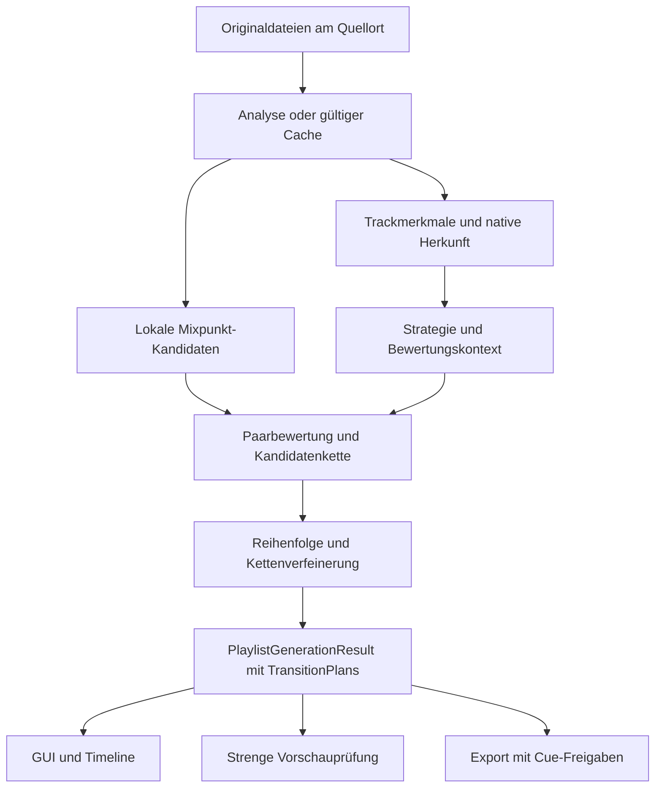

# Playlist-Entscheidungen und Mixpunktfluss in HPG

Quellenabgleich 26.10.2026. Aktuelle Cacheversion und Validierungsregeln:
`hpg_core/caching.py`. Keine historische Cachezahl oder DB-Datei als Ziel übernehmen.

Die Darstellung beschreibt Zuständigkeiten, keine neue Laufzeitmessung.
`playlist.generate_playlist_result` ist der Einstieg. `_build_generation_result`,
`_rank_fixed_boundaries`, `_select_snapshot_path` und `_refine_order_with_chain`
verbinden Reihenfolge und lokale Kandidatenwahl. Eine ausschließlich getrennte
„erst endgültig sortieren, dann einmal Mixpunkte wählen“-Beschreibung bildet
den aktuellen Verfeinerungspfad nicht vollständig ab.

## Die acht Strategien

Die maßgebliche Liste ist `playlist.STRATEGIES`:

| Name | Ziel |
|---|---|
| Harmonic Flow | passende harmonische Verbindungen und nutzbare Kette |
| Warm-Up | steigendes Tempo |
| Cool-Down | fallendes Tempo |
| Peak-Time | Energie-/Tempoverlauf mit Peak |
| Energy Wave | wechselnder Energieverlauf |
| Genre Flow | Genregruppen und Verbindungen |
| Consistent | kleine Tempo-/Energieänderungen |
| Context Flow | Energieziel, Setverlauf und Genrekontext |

Altnamen werden über `STRATEGY_ALIASES` übersetzt. Parameter wirken nur in den
Strategien, die sie laut `SUPPORTED_STRATEGY_PARAMETERS` unterstützen.
Bei Harmonic Flow werden Pools bis sechs Tracks vollständig permutiert;
größere Pools verwenden begrenzte Suchverfahren. Das ist kein Beweis für
eine weltweit optimale oder musikalisch beste Reihenfolge.

## Analyse und lokale Zeitpunkte

`analysis.analyze_track` liefert individuelle Trackdaten. Native Beats und
Phrasen werden mit ihrer Quelle und Prüfung gespeichert; DSP-Merkmale besitzen
ihre eigene Fensterabdeckung. Lokale Kandidaten entstehen unter anderem aus
nativen Phrasen, verifiziertem PSSI, benannten Cues und Strukturmerkmalen.

Die wirksame Phrasenlänge, der Trackanker und Taktpositionssperren müssen zum
aktuellen Verbraucher-Vertrag passen. Native Taktposition ist bei verifiziertem
nativen Grid nach Nutzerfreigabe verwendbar; `native_candidate` bleibt sichtbar
und wird nicht als unabhängige musikalische Bestätigung umetikettiert.

## Paar und Kette

Ein Übergang besitzt eine Richtung: A nach B ist nicht dasselbe wie B nach A.
Tempo, Harmonie, lokale Messwerte, Struktur, Blendenlänge und Quellenqualität
begrenzen die Kandidaten. Unbekannte Vocals allein sperren das Paar nicht.
Für B muss der eingehende Übergang mit seinem ausgehenden Übergang vereinbar
sein. Der lokal höchste Score kann deshalb zugunsten einer nutzbaren Kette
zurücktreten. Reicht kein Kandidat aus, bleibt die Grenze ungeplant.

## Eingaben und Ergebnisbildung

`generate_playlist_result` prüft Strategie und Toleranzen, friert den
Bewertungskontext und vorhandene Kandidatenwahlen ein. Unbrauchbare BPM
führen zum Ausschluss; fehlende Tonart wird im vorgesehenen Fallback behandelt.
Die ursprünglichen Analysepunkte eines Tracks sind nicht automatisch die
endgültigen Mixpunkte jeder konkreten Paarung.

## Gemeinsamer Ergebnisvertrag

`PlaylistGenerationResult` hält Reihenfolge, Kandidatenentscheidungen und Pläne
fest. GUI, Timeline und Export verwenden diese Entscheidung. Die Vorschau
erstellt ihre Spezifikation über `TransitionClipSpec.from_plan`; sie berechnet
keinen konkurrierenden Plan. Pedalboard-Stretch und die 6-ms-Kick-/Beatprüfung
im Renderer bleiben eigene technische Schritte.

Die frühere [PNG-Systemkarte](trackauswahl-mixpoints-systemkarte.png) ist ein
historischer Illustrationsstand. Für den aktuellen Ablauf gelten diese
Quellen und der Code, nicht die unveränderte Grafik.

## Was ein Score aussagt

Scores ordnen Kandidaten unter dem jeweiligen Vertrag. Sie sind weder
kalibrierte Erfolgswahrscheinlichkeiten noch unabhängige Hörurteile. Neue
Scores müssen die Reihenfolge nicht ändern. Eine erfolgreiche Einzelpaar-
Vorschau beweist keine lückenlose Playlist.

Nachweisgrenzen und offene Playlist-Lücken: [Quellenstand](../PRODUCTION_STATUS.md).
